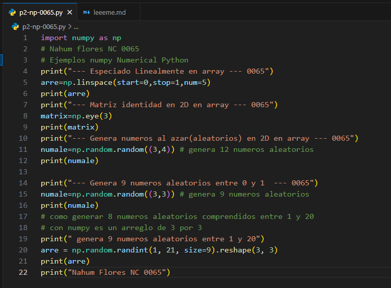
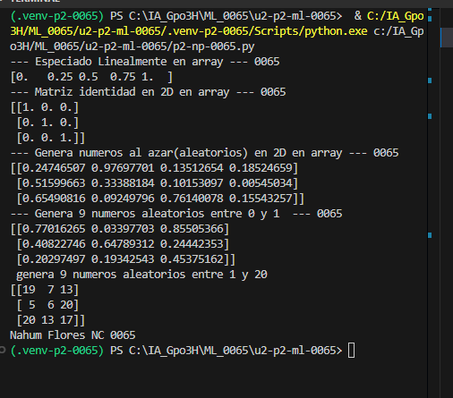

## Parametros
start=0: Especifica el valor inicial del intervalo, es decir, el número desde el cual comienza la secuencia. En este caso, comienza en 0.

stop=1: Especifica el valor final del intervalo. En este ejemplo, la secuencia termina en 1, incluyendo ese valor.

num=5: Indica cuántos números se generarán dentro del intervalo. En este caso, se generan 5 números con la misma distancia entre cada uno.

## como es que funciona np.linspace
np.linspace: Es una función de la biblioteca NumPy que permite generar una cantidad determinada de números distribuidos uniformemente dentro de un intervalo.

## el codigo

## resultado 
